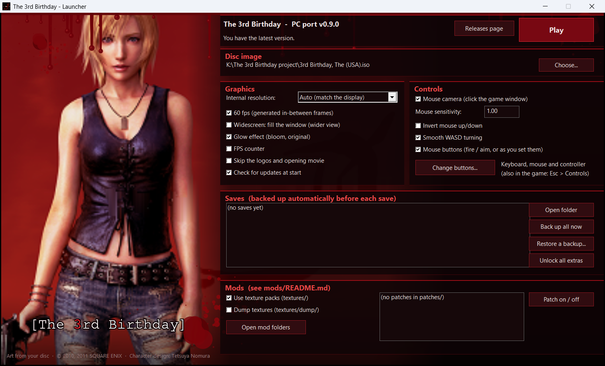
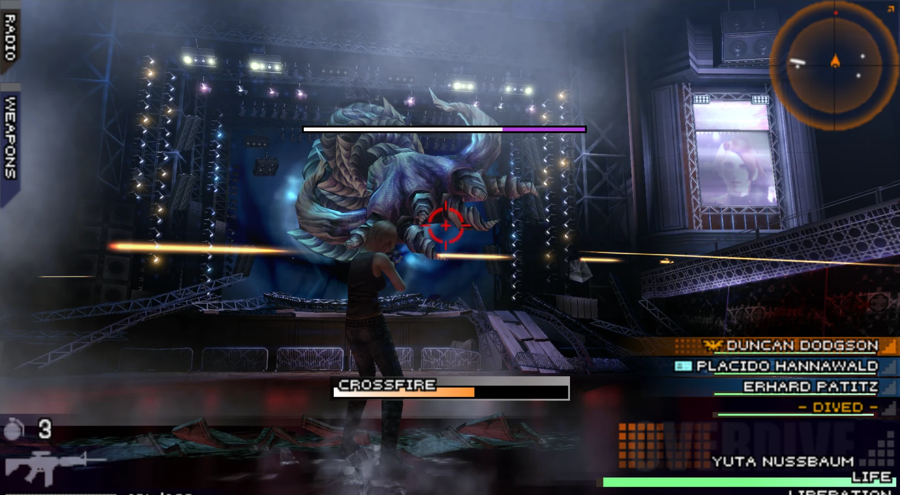
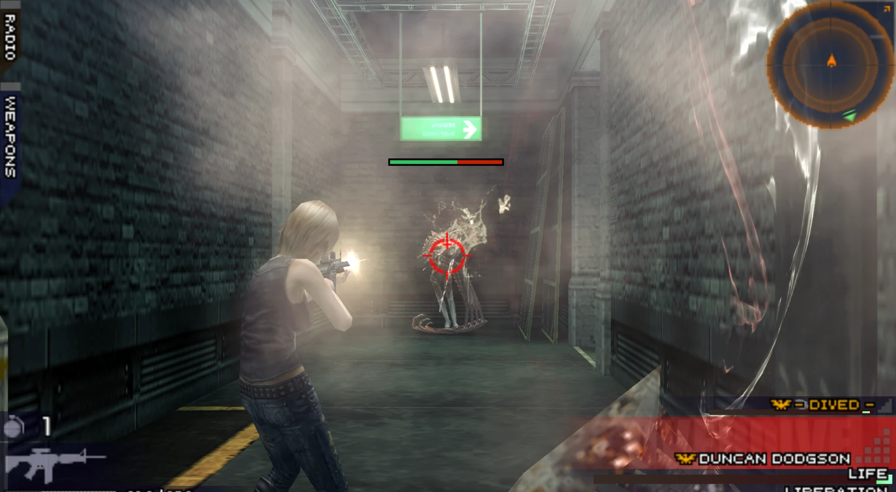
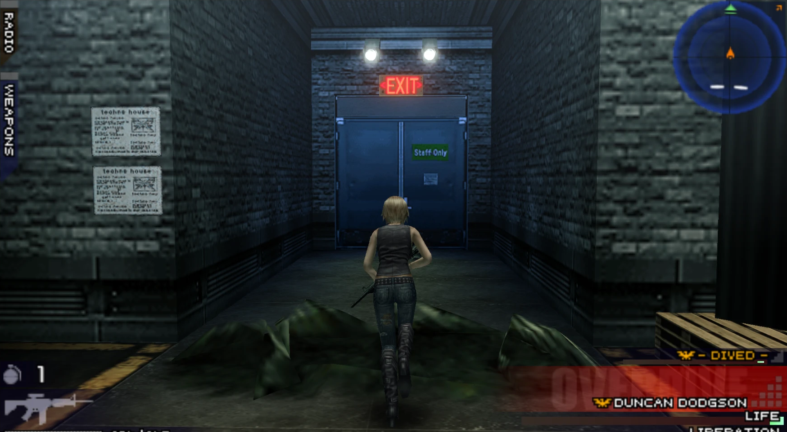

# The 3rd Birthday — native PC port (static recompilation)

A native Windows build of **The 3rd Birthday** (PSP, US release ULUS10567), made by
statically recompiling the game's MIPS code to C and running it on a native runtime
with a Vulkan renderer. It is not an emulator: the game logic runs as compiled PC code.

**Work in progress.** All 111 scenes of the game load and run at full speed, with movies,
voice, music and saving, but few people have played it through yet. Expect bugs, and please
report them.

You need your own copy of the game (a PSP disc image you dumped yourself). No game data
is included in this repository or in the releases.

## Playing it

1. Download `The3rdBirthday-<version>.zip` from the
   [Releases](https://github.com/BasedYuki/the-3rd-birthday-recomp/releases) page and extract it.
2. Start `The 3rd Birthday.exe` (the launcher) and choose your own disc image of the game
   (USA, ULUS10567, `.iso`).
3. Press **Prepare game**. The game is built once, on your PC, from your disc (3-10 minutes;
   nothing is downloaded). Then press **Play**.

The download contains no game code or data: only the PC runtime, the launcher and a kit
(compiler, Python, translation tools) with which your PC turns your disc into the game.

## The launcher

`The 3rd Birthday.exe` is where you start the game and change its settings without opening
any files:

- **Disc image**: finds your `.iso` next to it or lets you choose one, and checks it is the
  right game
- **Prepare game / Play**: builds the game from your disc the first time (with a progress
  bar), then starts it. After an update it tells you when the game needs preparing again.
- **Graphics**: internal resolution, 60 fps, widescreen, glow, FPS counter, skip the intro,
  check for updates at start
- **Controls**: mouse camera, mouse sensitivity and invert, smooth WASD turning (keys and
  buttons are remapped in the game: Esc > Controls)
- **Saves**: your saves with their episode and play time; open the folder, back up all,
  restore a backup. **Unlock all extras** unlocks every costume, the extra DNA boards and
  the Cheat Codes; your progress is kept.
- **Mods**: texture packs on/off, texture dump, memory patches on/off
- **Updates**: says whether you have the newest version, with a link to the Releases page

The background is the game's own PSP cover art (Aya on red, as on the PSP's home screen),
read from **your** disc image when the launcher starts; it is not included in the download.
The blood drips and splatters are drawn by the launcher, and the window icon is the disc's
icon. Until a disc image is chosen, the background is dark red with the blood only.

## Screenshots

## What works

- Boot, menus, movies (H.264 via Windows Media Foundation) with their audio
- Gameplay with ATRAC3/ATRAC3+ music and voices and the PSP sound chip (SAS)
- Optional: skip the boot logos and the opening movie (setting "Skip intro at start", off by default)
- Saving and loading (a virtual memory stick; a "Game saved" notice after each save)
- Vulkan renderer at higher internal resolution (4x the PSP's on a 1080p screen)
- **60 fps**: the game runs at 30 fps; an in-between frame is generated on the GPU for every
  game frame (camera, objects and limb animation are blended). It can be switched back to 30
  in the settings menu.
- **Widescreen / ultrawide** (settings menu, "Aspect ratio"): the game renders a wider view to
  fill the window; the HUD keeps its shape in the middle
- **Remappable controls** (settings menu, "Controls"): two keys and a controller button per action
- **Mouse camera**: click the game window and the mouse turns the camera (left button fires, right
  aims; Esc releases the mouse); smooth WASD turning
- **Launcher** (`The 3rd Birthday.exe`): disc image, settings, save list with backup / restore,
  unlock all extras, mods, update status, Play (see [The launcher](#the-launcher))
- **Update notice**: the game and the launcher tell you when a newer release is out
- **Safe saves**: every save is written safely and the previous one is kept in `memstick/BACKUP/`
- FPS counter and a glow (bloom) on/off switch in the settings menu
- **Mods**: HD texture packs, memory patches and compiled code mods, see [`mods/README.md`](../mods/README.md)
- Data Install (Extra menu) works, and **Use Install Data** reads from it like on a PSP
- Saves from a real PSP or PPSSPP can be imported (`tools/save_import.py`); the port's saves load in PPSSPP
- Xbox, PlayStation and other controllers through SDL3, plus keyboard
- **Twin-stick camera**: the right stick orbits the camera around Aya. Aiming follows
  the camera, and the game's own cameras take over for aiming, Overdive and Liberation.

## Controls

| Action | Controller | Keyboard |
| --- | --- | --- |
| Move | Left stick | W A S D |
| Camera (twin-stick orbit) | Right stick | I / J / K / L |
| Aim while holding L | Right stick (or left stick) | I / J / K / L |
| Reset camera behind Aya | Right stick click (R3) | O |
| Camera / fire / aim with the mouse | — | click the window, then mouse / left button / right button |
| Cross / Circle / Square / Triangle | A / B / X / Y | X or Space / Z / C / V |
| L / R | LB or LT / RB or RT | Q / E |
| D-pad (the game's own camera turn) | D-pad | Arrow keys |
| Start / Select | Menu / View | Enter / Tab |
| Settings menu (pauses the game) | View + Menu together | Esc |
| Screenshot (full render resolution, saved to `screenshots/`) | — | F12 |
| Fullscreen | — | F11 or Alt+Enter |

## Settings

Most options are in the launcher and in the in-game settings menu (Esc). They are stored in
plain text files next to the executable (created on first run):

- `graphics.cfg` — `render_scale` (0 = match the display, or 1 to 8), `frame_interpolation` (1 = 60 fps), `skip_intro` (1 = skip logos and opening movie; default 0), `widescreen` (1 = fill the window), `texture_dump` (1 = write the game's textures to `textures/dump/` for texture packs)
- `controls.cfg` — key and controller bindings (edited by the Controls page)
- `twinstick.cfg` — `sensitivity`, `invert_x`, `invert_y`, `recenter`,
  `recenter_delay`, `recenter_delay_still`

## Building

The toolchain is MSYS2 UCRT64 (GCC, SDL3, Vulkan headers, glslc). See
[`runtime/README.md`](../runtime/README.md) for the recompiler and runtime, and
[`PLAN.md`](../PLAN.md) for the design decisions and a dated log of the work.
`scripts/setup.ps1` sets up a fresh clone (MSYS2 packages, the program decrypted from your
disc image) and builds; `scripts/build.ps1` rebuilds. The build makes `ULUS10567.exe` (the
runtime, no game code) and `game.dll` (the game's code, recompiled). `scripts/package.ps1`
makes the release package (runtime, launcher, kit; checked to hold no game code) and
`scripts/release.ps1` publishes it.

## Versions

`VERSION` holds the current version; [`docs/CHANGELOG.md`](../docs/CHANGELOG.md) lists what
changed. A release carries the notes and the package; the game code is always built from your
own disc on your PC, so a release never contains it.

## Credits and license

GPL-2.0-or-later. This project builds on other people's work — see
[`runtime/CREDITS.md`](../runtime/CREDITS.md):

- [PPSSPP](https://github.com/hrydgard/ppsspp) — the reference for PSP behaviour; several
  HLE modules (sceMpeg, SAS, ATRAC) are ported from it
- [AljandrOrtega's PSP recompilation toolkit](https://github.com/AljandrOrtega/PSP-recompilation-project) — the recompiler and runtime this port started from
- FFmpeg's ATRAC decoder (via PPSSPP's at3_standalone), SDL3

Much of the code was written with the help of an AI model (Anthropic's Claude); the
details are in [`runtime/CREDITS.md`](../runtime/CREDITS.md).

*The 3rd Birthday* is a trademark of Square Enix. This project is not affiliated with or
endorsed by Square Enix.
